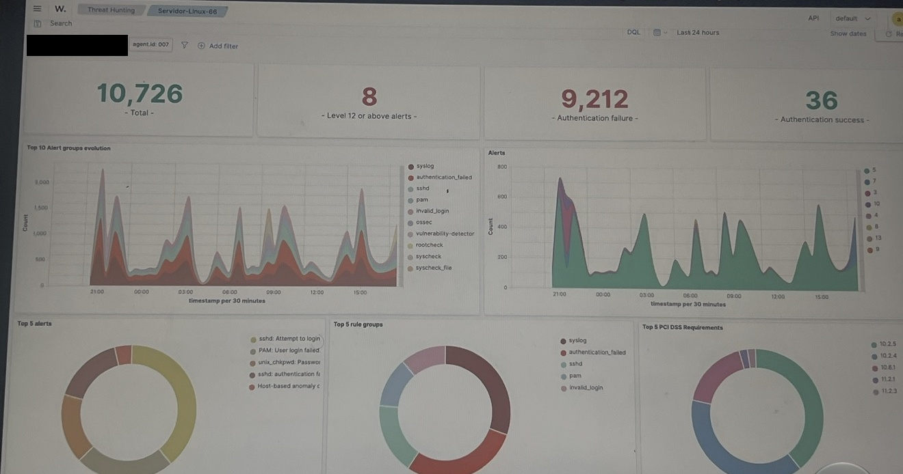

# Wazuh SIEM deployment and SSH alert investigation

**Alejandro Báez Santana · Personal security operations lab**

I deployed a Wazuh manager, configured a Linux endpoint to report to it, and reviewed authentication activity in the dashboard. The dashboard below shows what I could see for one Linux agent over 24 hours.

## What the dashboard recorded

| Source | Total alerts | Authentication failures | Authentication successes | Level 12 or above |
| --- | ---: | ---: | ---: | ---: |
| Threat Hunting · Servidor-Linux-66 · last 24 hours | 10,726 | 9,212 | 36 | 8 |
| [Security Events · January 8 capture](january-alerts.jpg) | 1,299 | 698 | 39 | 0 |
| Earlier lab notes · original reporting window unavailable | 1,952 | 1,333 | — | — |

Each row represents a separate observation. The 36 successful authentications in the first view warrant review alongside the failures. To assess whether any login was unauthorized, I would compare account, source and timestamp in the underlying events with accepted SSH sessions on the host. The available evidence consists of dashboard totals and host-side samples. An event-level Wazuh export is still missing.

## From server to monitored endpoint

| Stage | Evidence | What I observed |
| --- | --- | --- |
| Cloud infrastructure | [AWS EC2 instance](ec2-instance.jpg) | The EC2 console showed a stopped t3.medium instance during resizing. My earlier VPS notes separately recorded 2 vCPU, 2 GB RAM and 80 GB storage. |
| Manager startup | [Linux service status](manager-status.jpg) | On May 28, 2026, systemd reported the Wazuh manager enabled and active. The output lists analysis, remote collection and monitoring processes. |
| Linux agent configuration | [Agent settings in the editor](linux-agent.jpg) | I configured TCP port 1514 and the enrollment name Servidor-Linux-66. The same name appears in the dashboard above under agent ID 007. |
| macOS endpoint | [Local Wazuh startup output](mac-agent.jpg) | The local Wazuh processes reported starting. The original terminal photo also records a duplicate enrollment name. Central enrollment on the Mac remains unverified. |

## Troubleshooting notes

**Agent connectivity.** My January 8 notes describe a timeout to TCP 1514. I compared the manager's TCP listener with a UDP firewall allowance and investigated a separate agent/manager version compatibility error. The notes leave the final recovery step open.

**Package conflict.** During the May deployment, the Ubuntu package manager rejected the agent package because the manager package was already installed on that machine. I checked the manager service on the server and inspected the agent configuration on the Linux endpoint. [Package-manager output](package-conflict.jpg)

## Companion SSH hardening exercise

My Wazuh notes list SSH keys, disabling direct root login, geographic access restrictions and Fail2Ban. In a separate exercise on an Ubuntu 22.04 VPS, I configured the sshd jail to ban after five failures within ten minutes. I checked the ban in the Fail2Ban log and verified access after a manual unban.

[Redacted log excerpts](host-evidence.md) · [Six original SSH screenshots](https://github.com/Alexcyberdr/fail2ban-ssh-hardening-lab/tree/main/evidence/screenshots) · [Jail configuration](https://github.com/Alexcyberdr/fail2ban-ssh-hardening-lab/blob/main/config/jail.local)

The Wazuh images are cropped from my original lab photos to remove unrelated screen content and infrastructure identifiers.
